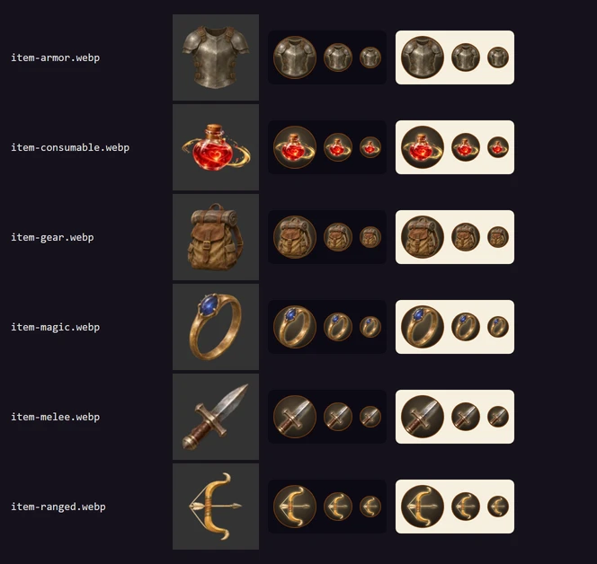

# Item kinds on the sheet, 14 November 2026

A character sheet's item chips and wear rows lead with a picture 32px and
24px across. An item's own painting cannot be told from another's at that
size, and every unpainted item fell back to the same gear plate, so the
picture said nothing. The rows now show which of six kinds the item is:

| Kind | Picture | Where it came from |
| --- | --- | --- |
| Melee weapon | a dagger | the Hand's Dagger card, turned and cut square |
| Ranged weapon | a bow with an arrow nocked | new painting |
| Armor or shield | a breastplate with shoulder plates | new painting |
| Used up when used | a red potion | the Hand's Potion of Healing card, cut square |
| Magic item | a gold ring with a blue gem | new painting |
| Gear | a backpack | new painting |

Which item is which kind is in `src/lib/srd/item-category-logic.ts`;
`scripts/test-item-categories.mjs` holds it. A magic weapon or suit shows the
weapon's or the armor's picture, not the ring's; for one no engine table
knows, the content pack's own category says which (the `wielded` lists of
`src/lib/classes/item-tags.json`). The item's own painting stays
in the chip's hover, where it has room, and there it is the Hand card's
painting when the item has one.

## Files

The six ship as `public/assets/icons/glyph/item-<kind>.webp`, 128x128 with
alpha. [provenance.json](provenance.json) records each one's source, the
Codex prompt where one was used, the edit made in code, and the SHA-256 of
the source and of the shipped file.

The two cut from Hand cards are the approved paintings with nothing
repainted. The four new ones were painted by Codex's built-in image tool on
a flat magenta ground, which was keyed out in code, with four Hand cards
(the dagger, the shortbow, the potion, the rope) attached as the style to
keep: real objects in worn steel, wood and leather, with no outline or
glow. A first set, painted without them, read as glossy game icons beside
the dagger and was dropped. The bow is paler and stouter than the Hand's
shortbow, which is lost on the plate at 24px. All four are plain
objects of no setting's own design: no creature, character or named place.

## Review

Each row shows the shipped file, then the round plate the sheet draws it on
at 48, 32 and 24px, on the night and the day surround. Open the image at
100% to judge the small sizes.
